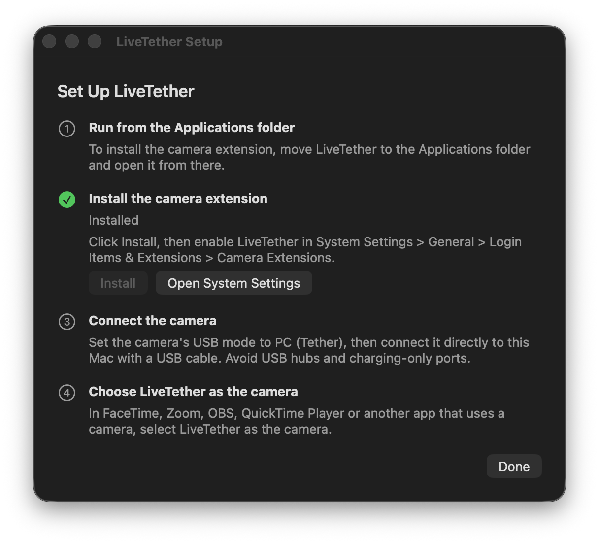
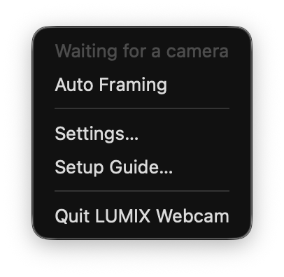
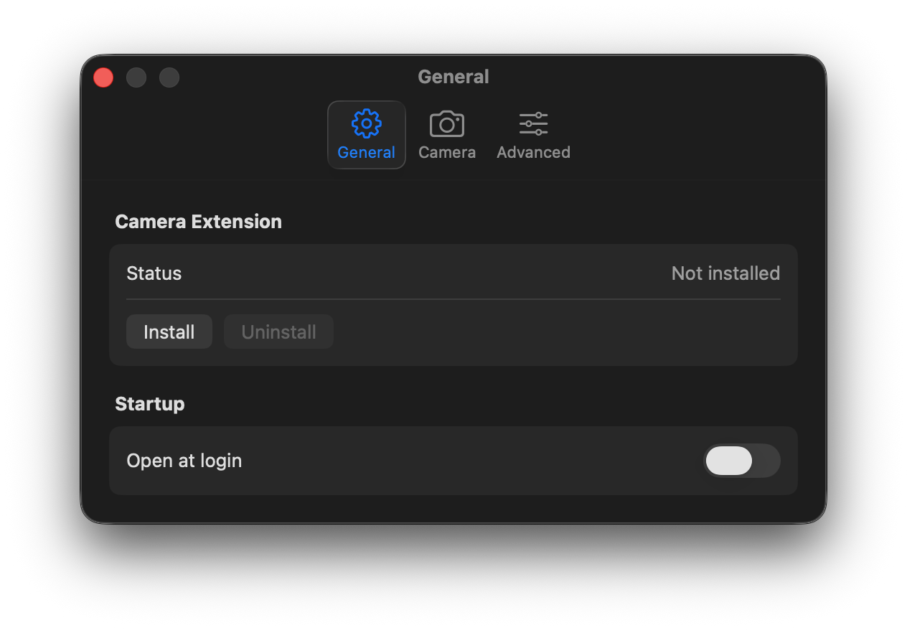
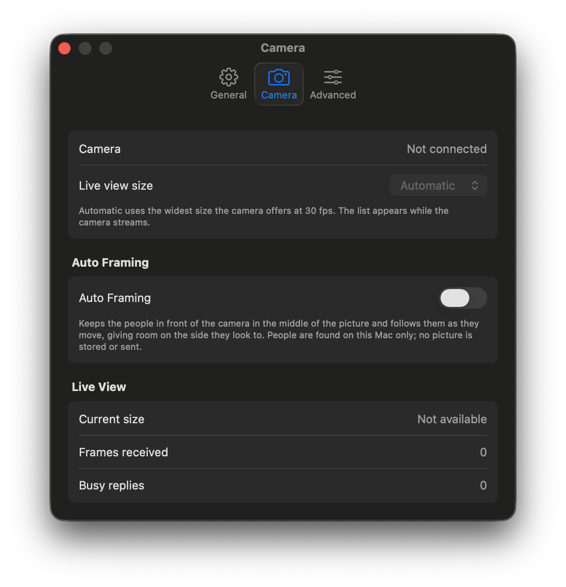
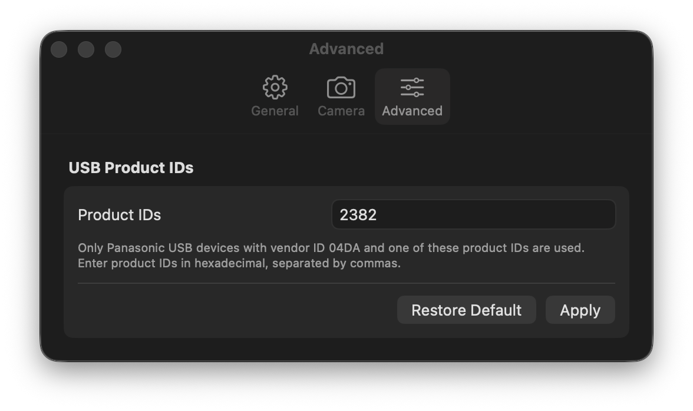

<p align="center">
  
</p>

<h1 align="center">LUMIX Webcam</h1>

LUMIX Webcam turns the live view of a Panasonic LUMIX camera connected over USB into a webcam on
macOS 14.1 and later. Any app that uses a camera can choose it: FaceTime, QuickTime Player, OBS,
web browsers and video-conferencing apps.

Panasonic's LUMIX Webcam Software does not support macOS 14.1 and later. LUMIX Webcam is a separate
app built on Apple's Core Media I/O camera extension API.

LUMIX Webcam is an independent project. It is not made, endorsed or supported by Panasonic.
LUMIX and Panasonic are trademarks or registered trademarks of Panasonic Holdings Corporation and
are used here only to name the cameras this app works with. All other trademarks belong to their
respective owners.

## How it works

- The menu bar app finds the camera through ImageCaptureCore and opens a PTP session with it.
  While an app is using LUMIX Webcam, it turns on the camera's live view, fetches JPEG frames at up
  to 30 fps, decodes them and passes them to the camera extension. When no app is using LUMIX
  Webcam, it turns live view off.
- The camera extension publishes a camera named LUMIX Webcam with 1920 × 1080, 1280 × 720 and
  1280 × 960 formats at 30 fps. It fits the camera picture into the format the app chose, with
  black bars where the aspect ratios differ. While no camera picture arrives, it shows a standby
  screen that says why.
- With Auto Framing on, the app finds the people in each picture and crops the picture around
  them, following them smoothly as they move. The eyes sit in the upper third of the picture, and
  a face turned to one side gets extra room on that side. People are found in a small grayscale
  copy of the picture, on this Mac only; no picture is stored or sent.

The app sends the camera only the commands live view needs: open and close a session, read and
set the live-view size, turn live view on and off, and fetch live-view frames. These Panasonic PTP
operations and their parameters are documented in the open-source
[libgphoto2](https://github.com/gphoto/libgphoto2) project (`camlibs/ptp2/ptp.h`). The app never
sends commands that change camera settings, format a card or update firmware.

## Requirements

- macOS 14.1 or later
- A LUMIX camera that supports USB tethering, and a USB cable. Connect the camera directly, not
  through a USB hub or a charge-only port.

## Set up

1. Move LUMIX Webcam to the Applications folder and open it. A camera icon appears in the menu bar,
   and the setup guide opens.
2. Click Install in the setup guide, then allow LUMIX Webcam in System Settings > General >
   Login Items & Extensions > Camera Extensions.
3. Set the camera's USB mode to PC (Tether) and connect it to the Mac.
4. In the app you want to use, choose LUMIX Webcam as the camera.

<p align="center">
  
</p>

The menu bar icon opens a menu with the camera status, Auto Framing, the settings window and the setup guide.

<p align="center">
  
</p>

| Tab | Settings |
| --- | --- |
| General | Install or uninstall the camera extension, open LUMIX Webcam at login |
| Camera | The live-view size the camera sends (Automatic picks the largest size at 30 fps), Auto Framing, frame statistics |
| Advanced | The USB product IDs of the cameras LUMIX Webcam uses (default `0x2382`) |

<p align="center">
  
  
  
</p>

If the camera is connected but LUMIX Webcam does not find it, look up the camera's product ID in
System Information > USB and add it on the Advanced tab.

To remove LUMIX Webcam, click Uninstall on the General tab, then delete the app.

## Build

Building needs Xcode 26 (Swift 6.2) and [XcodeGen](https://github.com/yonaskolb/XcodeGen).

```sh
xcodegen generate
xcodebuild -project LumixWebcam.xcodeproj -scheme LumixWebcam -configuration Release \
  -derivedDataPath build/DerivedData -allowProvisioningUpdates build
```

A camera extension only loads when the app and the extension are signed, and the app can only
install it while it runs from the Applications folder. To build under your own Apple developer
team, set `DEVELOPMENT_TEAM` in `project.yml`, change `bundleIdPrefix` there, and change
`ExtensionInstaller.extensionIdentifier` in `App/ExtensionInstaller.swift` to match.

The app icon is drawn by a script; run it again after changing the drawing:

```sh
swift scripts/make-app-icon.swift App/Assets.xcassets/AppIcon.appiconset
```

## Test

```sh
cd Packages/LumixKit && swift test
python3 scripts/check-localization.py
```

`scripts/check-window-layout.swift` opens the setup guide and every settings tab of a built app in
English, Korean and Japanese, and reports text cut short with an ellipsis, content that scrolls,
and windows taller than the screen. Quit LUMIX Webcam first. The check brings the app's windows to
the front for about ten seconds per language, and the terminal needs the Accessibility and Screen
Recording permissions. `--screenshots <directory>` also saves each window as a screenshot.

```sh
swift scripts/check-window-layout.swift "build/DerivedData/Build/Products/Release/LUMIX Webcam.app"
```

`lumix-sink-probe` checks the camera extension without a camera. Quit LUMIX Webcam first, because
only one program can feed the extension at a time, then run:

```sh
cd Packages/LumixKit && swift run lumix-sink-probe 30 1280 960
```

It feeds a moving test pattern of the given size to the extension for the given number of
seconds. Choose LUMIX Webcam in a camera app to see it.

`lumix-framing-probe` runs Auto Framing over a video file with people in it, using the same
detector, framer and cropper as the app. It prints how often people were found, how long a
detection takes and how far the crop moved, and feeds the framed picture to the extension unless
`--no-sink` is given:

```sh
cd Packages/LumixKit && swift run lumix-framing-probe ~/Movies/people.mov
```

## Repository layout

| Path | Contents |
| --- | --- |
| `App/` | The menu bar app: settings, setup guide, extension installer, app icon |
| `CameraExtension/` | The Core Media I/O camera extension |
| `Packages/LumixKit/Sources/LumixProtocol/` | PTP containers and the Panasonic live-view messages |
| `Packages/LumixKit/Sources/LumixSession/` | The camera session, the link state machine and reconnection |
| `Packages/LumixKit/Sources/LumixImageCapture/` | The ImageCaptureCore transport and camera discovery |
| `Packages/LumixKit/Sources/LumixVideo/` | JPEG decoding, letterboxing, the standby screen and Auto Framing |
| `Packages/LumixKit/Sources/LumixVirtualCamera/` | The frame and status channels between the app and the extension |
| `Packages/LumixKit/Tools/SinkProbe/` | `lumix-sink-probe` |
| `Packages/LumixKit/Tools/FramingProbe/` | `lumix-framing-probe` |
| `scripts/check-localization.py` | The localization check |
| `scripts/check-window-layout.swift` | The window layout check |
| `scripts/make-app-icon.swift` | The app icon drawing |
| `.github/images/` | The screenshots in this file |

## Localization

LUMIX Webcam is written in English and translated into Korean and Japanese. Each `ko.lproj` and
`ja.lproj` string table must hold exactly the keys of its English table, with the same format
specifiers, and every localized string in the app's Swift sources must have an English entry.
`scripts/check-localization.py` checks both.

## Trademarks

LUMIX and Panasonic are trademarks or registered trademarks of Panasonic Holdings Corporation.
LUMIX Webcam is not affiliated with, endorsed by or supported by Panasonic.
